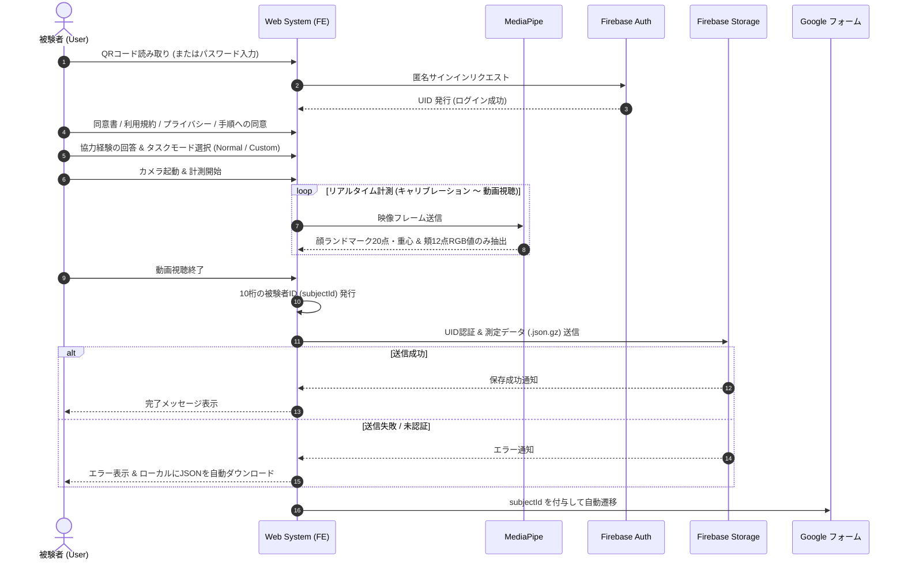

# Evaluation System (評価用データ収集システム)

本ディレクトリは、オンライン授業・オンデマンド授業における学習者の集中度を推定するAIの評価を目的とした、リアルタイム計測および評価データ収集用Webアプリケーションです。

## プロジェクト概要

被験者に講義動画およびリラックス動画を視聴してもらい、Webカメラを通じて目や頭部回転角などのランドマーク座標と頬部分のRGB値をリアルタイムで抽出・収集します。カメラの映像自体や顔画像そのものはサーバーに送信・保存せず、抽出されたデータのみを安全に保持・送信する設計となっています。

## 主な機能

1. **段階的な事前同意・確認フロー**
   - QRコード読み取りまたはパスワード入力による認証と Firebase 匿名サインイン。
   - インフォームドコンセント、利用規約、プライバシーポリシー、実験手順の確認・同意。
   - 過去の学習データ収集への協力経験（`experienced`: `0` / `1`）の確認。

2. **リアルタイム顔認識 & キャリブレーション**
   - Google MediaPipe FaceLandmarker を利用したリアルタイム顔認識。
   - 計測開始直後に **5秒間のキャリブレーション**（正面注視）を実施し、20特徴点の平均座標（`meanLandmarks`）を算出。
   - 計測中に顔が認識できなくなった場合の即時警告オーバーレイ表示。

3. **モード別の動画視聴とデータ計測**
   - **Normal モード (`video_mode: 0`)**: 集中タスク動画（`cnn.mp4` / `label: 1`）視聴後に、ベースライン収集用のリラックス動画（`relax.mp4` / `label: 0`）を連続視聴。
   - **Custom モード (`video_mode: 1`)**: 検証用動画（`ts2vec.mp4` / `label: 2`）のみを視聴して計測完了。

4. **データ送信・フォールバック & 事後アンケート遷移**
   - セッションごとに10桁のランダムな被験者ID（`subjectId`）を発行し、計測データを gzip 圧縮 JSON として Firebase Storage（`user_signals/${uid}/pbl-b18-${subjectId}.json.gz`）へアップロード。
   - 未認証または通信エラー等で送信できない場合は、自動的にローカルへ JSON ファイルをダウンロード保存。
   - 保存処理完了後、被験者IDをクエリパラメータに付与した事後アンケート（Google フォーム）へ自動遷移。

## システムフロー



## 主要ファイル構成

```text
evaluation_system/
├── README.md
├── Dockerfile
├── cors.json                       # Firebase Storage CORS設定
├── .env.example                    # 環境変数テンプレート
├── package.json
│
├── app/
│   ├── api/
│   │   └── content/
│   │       └── route.ts            # 同意書・利用規約等のMarkdownコンテンツ取得API
│   ├── components/
│   │   ├── QrScanner.tsx           # QRコード読み取りコンポーネント (html5-qrcode)
│   │   └── TaskScreen.tsx          # 計測画面UI（カメラ・動画再生・警告表示）
│   ├── hooks/
│   │   ├── useFaceLandmarker.ts    # MediaPipe FaceLandmarker初期化フック
│   │   ├── useWebcam.ts            # Webカメラ映像取得フック
│   │   └── useMeasurement.ts       # キャリブレーション・計測ループ・保存/遷移制御フック
│   ├── lib/
│   │   ├── firebase.ts             # Firebase初期化・Storageアップロード/JSON保存処理
│   │   ├── landmarks.ts            # 顔ランドマーク抽出インデックス・重心・平均計算
│   │   ├── rppg.ts                 # 12点ROI rPPG RGB抽出処理
│   │   └── survey.ts               # 事後アンケート(Googleフォーム)URL生成・自動遷移
│   ├── ConcentrationApp.tsx        # 実験フロー全体のUI・状態遷移コンポーネント
│   ├── layout.tsx                  # アプリケーション全体のルートレイアウト
│   ├── page.tsx                    # 被験者ログイン・認証ページ (QR / パスワード)
│   ├── types.ts                    # 計測データおよび状態の型定義
│   └── globals.css                 # グローバルスタイル定義
│
├── public/
│   ├── cnn.mp4                     # Normalモード用 集中タスク動画 (label: 1)
│   ├── relax.mp4                   # Normalモード用 リラックス動画 (label: 0)
│   └── ts2vec.mp4                  # Customモード用 検証動画 (label: 2)
│
└── content/
    ├── informed_consent.md         # インフォームドコンセント
    ├── introduction.md             # 実験手順・注意事項
    ├── privacy.md                  # プライバシーポリシー
    └── terms.md                    # 利用規約
```

## 保存データ構造（`app/types.ts` 準拠）

Firebase Storage に保存（およびローカルダウンロード）される JSON は `MeasurementRecord` 型に準拠しています。

```json
{
  "subjectId": "A1B2C3D4E5",
  "clientCreatedAtMs": 1731800000000,
  "experienced": 0,
  "video_mode": 0,
  "calibration": {
    "durationSec": 5.0,
    "frameCount": 150,
    "meanLandmarks": {
      "ear": {
        "lm[362]": { "x": 0.0, "y": 0.0, "z": 0.0 }
      },
      "headPose": {
        "lm[4]":  { "x": 0.0, "y": 0.0, "z": 0.0 },
        "lm[10]": { "x": 0.0, "y": 0.0, "z": 0.0 }
      },
      "gaze": {
        "lm[473]": { "x": 0.0, "y": 0.0, "z": 0.0 },
        "lm[468]": { "x": 0.0, "y": 0.0, "z": 0.0 }
      }
    }
  },
  "data": [
    {
      "time": 0.033,
      "clientEpochMs": 1731800005033,
      "clientPerfMs": 12345.67,
      "label": 1,
      "video_mode": 0,
      "rppg": {
        "lm330": { "r": 180, "g": 140, "b": 120 },
        "leftCheek":  { "r": 180.0, "g": 140.0, "b": 120.0 },
        "rightCheek": { "r": 179.0, "g": 139.0, "b": 119.0 },
        "bothCheeks": { "r": 179.5, "g": 139.5, "b": 119.5 }
      },
      "landmarks": {
        "ear": { "...": "16特徴点 (lm[362], lm[133], lm[384], lm[157], lm[385], lm[158], lm[386], lm[159], lm[263], lm[33], lm[373], lm[144], lm[374], lm[145], lm[380], lm[153])" },
        "headPose": { "...": "2特徴点 (lm[4], lm[10])" },
        "gaze": { "...": "2特徴点 (lm[473], lm[468])" }
      },
      "landmarkCentroid": { "x": 0.5, "y": 0.5, "z": 0.0 }
    }
  ]
}
```

### 主な型定義とフィールド説明

| 型名 / フィールド | 内容 |
| :--- | :--- |
| `MeasurementRecord` | 保存データのルートオブジェクト (`subjectId`, `clientCreatedAtMs`, `experienced`, `video_mode`, `calibration`, `data`) |
| `experienced` | 学習データ収集への協力経験 (`1`: 協力した / `0`: していない) |
| `video_mode` | 選択されたタスクモード (`0`: Normal / `1`: Custom) |
| `CalibrationStats` (`calibration`) | 5秒間キャリブレーションの計測時間 (`durationSec`)、フレーム数 (`frameCount`)、20特徴点の平均座標 (`meanLandmarks`) |
| `CapturedFrame` (`data[]`) | 各フレームの経過時間 (`time`)、時刻 (`clientEpochMs`, `clientPerfMs`)、動画ラベル (`label`: `1`=cnn.mp4 / `0`=relax.mp4 / `2`=ts2vec.mp4)、モード (`video_mode`)、各種特徴量 |
| `RppgMetrics` (`rppg`) | 左頬6点 (`lm330`, `lm347`, `lm348`, `lm280`, `lm266`, `lm425`)・右頬6点 (`lm101`, `lm118`, `lm119`, `lm50`, `lm36`, `lm205`) の計12点個別RGB値と、左右・全体の平均RGB (`leftCheek`, `rightCheek`, `bothCheeks`) |
| `LandmarkPoints` (`landmarks`) | EAR用16点・頭部姿勢用2点・視線用2点の計20特徴点の生座標 (`RawLandmarkCoord`) |
| `landmarkCentroid` | MediaPipe 468点顔メッシュ (`FACE_MESH_LANDMARK_COUNT`) の重心座標 `[x, y, z]` |

## プライバシー & セキュリティ

- **映像データの非保持**: Webカメラの映像データや顔画像自体は外部サーバーに一切送信・保存されません。
- **最小限のデータ収集**: 指定された顔ランドマークの座標データ（20特徴点・重心）および頬12点のRGB値のみを取得・送信します。
- **匿名性の確保**: Firebase の匿名認証機能により発行される UID と、セッションごとに生成される10桁のランダムな `subjectId` のみで管理され、個人情報との紐付けは行われません。
- **通信暗号化**: Firebase との通信はすべて HTTPS で暗号化されています。

## 開発環境・セットアップ

- Node.js (v22 以上推奨)
- npm / yarn / pnpm

1. **パッケージのインストール**

   ```bash
   cd evaluation_system
   npm install
   ```

2. **環境変数 (`.env.local`) の設定**

   `.env.example` をコピーして `.env.local` を作成し、各値を設定してください。

   | 変数名 | 必須 | 設定内容・説明 | 取得先 / 設定先 |
   | :--- | :---: | :--- | :--- |
   | `NEXT_PUBLIC_FIREBASE_API_KEY` | 必須 | Firebase プロジェクトの API キー | Firebase Console (プロジェクト設定) |
   | `NEXT_PUBLIC_FIREBASE_AUTH_DOMAIN` | 必須 | Firebase Auth の認証ドメイン | Firebase Console (プロジェクト設定) |
   | `NEXT_PUBLIC_FIREBASE_PROJECT_ID` | 必須 | Firebase プロジェクト ID | Firebase Console (プロジェクト設定) |
   | `NEXT_PUBLIC_FIREBASE_STORAGE_BUCKET` | 必須 | Cloud Storage のバケット名 | Firebase Console (プロジェクト設定) |
   | `NEXT_PUBLIC_FIREBASE_MESSAGING_SENDER_ID` | 必須 | Firebase Cloud Messaging の送信者 ID | Firebase Console (プロジェクト設定) |
   | `NEXT_PUBLIC_FIREBASE_APP_ID` | 必須 | Firebase アプリケーション ID | Firebase Console (プロジェクト設定) |
   | `EXPERIMENT_PASSWORD` | 任意 | QR/パスワード認証画面で使用する実験用認証パスワード | 任意の英数字文字列 |
   | `NEXT_PUBLIC_SURVEY_FORM_BASE_URL` | 任意 | 計測完了後に自動遷移する事後アンケート (Google フォーム) の URL（※事前入力を使う場合は短縮URLではなく `viewform` URL を指定） | Google フォーム |
   | `NEXT_PUBLIC_SURVEY_FORM_SUBJECT_ENTRY_ID` | 任意 | 被験者IDを自動入力するフォーム項目のエントリー ID（例: `entry.419465595`） | Google フォーム（事前入力リンク取得） |

3. **ローカル開発サーバの起動**

   ```bash
   npm run dev
   ```

   ブラウザで <http://localhost:3000> にアクセスして動作を確認します。
